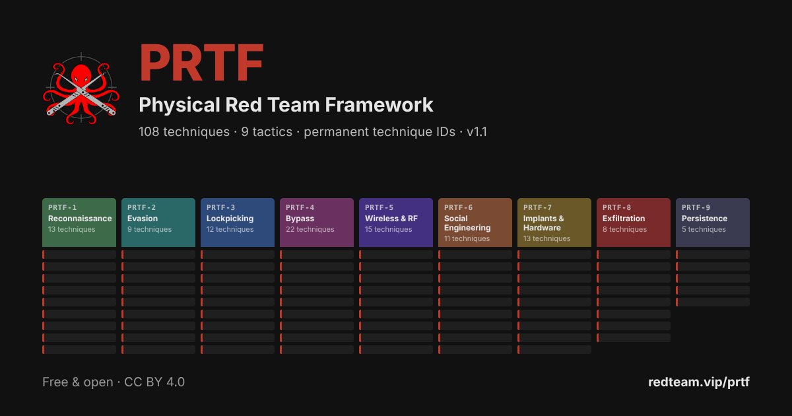

# PRTF — Physical Red Team Framework

<p align="center"></p>

PRTF is an open taxonomy of the tactics and techniques used in **authorized** physical red team engagements, from initial reconnaissance to sustained access. Think MITRE ATT&CK®, for physical security: a shared language for planning engagements, writing reports, and building defenses.

- **Interactive matrix:** [redteam.vip/prtf](https://redteam.vip/prtf/)
- **Data:** [`data/prtf.json`](data/prtf.json) (full content) and [`data/techniques.csv`](data/techniques.csv) (index)
- **License:** [CC BY 4.0](LICENSE). Free to use, share and adapt, including commercially, with credit.

## Technique IDs

Every technique has a permanent ID in the form `PRTF-<tactic>.<technique>`, for example `PRTF-3.05` (Disk Detainer Picking). IDs are **never reused or renumbered**. When a technique is retired, its ID is retired with it. You can cite an ID in a report today and it will mean the same thing in every future version.

Link to a single technique with `https://redteam.vip/prtf/#PRTF-3.05`.

## Each technique includes

- **Red team:** description, prerequisites, tools and resources, techniques it chains into, references
- **Blue team:** detection indicators, countermeasures, references
- **Ratings:** difficulty and detection risk (low / medium / high)

## The matrix

<!-- MATRIX:START -->
_PRTF v1.1 · 108 techniques across 9 tactics · generated from data/prtf.json_

### Tactics

- **PRTF-1 Reconnaissance** (13): The operator is gathering information about the site, its people and its security before going on site.
- **PRTF-2 Evasion** (9): The operator is trying to avoid being seen, recorded or challenged while on site.
- **PRTF-3 Lockpicking** (12): The operator is trying to open a mechanical lock without its key, leaving it working.
- **PRTF-4 Bypass** (22): The operator is trying to defeat a door, latch or lock without picking it.
- **PRTF-5 Wireless & RF** (15): The operator is trying to exploit Wi-Fi, RFID access credentials and other radio systems.
- **PRTF-6 Social Engineering** (11): The operator is trying to get people to grant access or share information.
- **PRTF-7 Implants & Hardware** (13): The operator is trying to place devices that give access to networks or systems.
- **PRTF-8 Exfiltration** (8): The operator is trying to collect evidence or data and get it out of the site.
- **PRTF-9 Persistence** (5): The operator is trying to keep or regain access after the first entry.

### Techniques

| **PRTF-1**<br>Reconnaissance | **PRTF-2**<br>Evasion | **PRTF-3**<br>Lockpicking | **PRTF-4**<br>Bypass | **PRTF-5**<br>Wireless & RF | **PRTF-6**<br>Social Engineering | **PRTF-7**<br>Implants & Hardware | **PRTF-8**<br>Exfiltration | **PRTF-9**<br>Persistence |
|---|---|---|---|---|---|---|---|---|
| [PRTF-1.01](https://redteam.vip/prtf/#PRTF-1.01)<br>Open Source Intelligence (OSINT) | [PRTF-2.01](https://redteam.vip/prtf/#PRTF-2.01)<br>Camera Avoidance & Blind Spot Mapping | [PRTF-3.01](https://redteam.vip/prtf/#PRTF-3.01)<br>Single Pin Picking (SPP) | [PRTF-4.01](https://redteam.vip/prtf/#PRTF-4.01)<br>Latch Slipping | [PRTF-5.01](https://redteam.vip/prtf/#PRTF-5.01)<br>Evil Twin / Rogue AP | [PRTF-6.01](https://redteam.vip/prtf/#PRTF-6.01)<br>Offensive Threat Modeling | [PRTF-7.01](https://redteam.vip/prtf/#PRTF-7.01)<br>HID Payload Injection | [PRTF-8.01](https://redteam.vip/prtf/#PRTF-8.01)<br>Document & Environment Photography | [PRTF-9.01](https://redteam.vip/prtf/#PRTF-9.01)<br>Planted Hardware |
| [PRTF-1.02](https://redteam.vip/prtf/#PRTF-1.02)<br>Aerial Reconnaissance | [PRTF-2.02](https://redteam.vip/prtf/#PRTF-2.02)<br>Behavioral Blending | [PRTF-3.02](https://redteam.vip/prtf/#PRTF-3.02)<br>Raking | [PRTF-4.02](https://redteam.vip/prtf/#PRTF-4.02)<br>Over-Door / Film Attack | [PRTF-5.02](https://redteam.vip/prtf/#PRTF-5.02)<br>Passive Capture / Handshake Collection | [PRTF-6.02](https://redteam.vip/prtf/#PRTF-6.02)<br>Pretexting & Scenario Building | [PRTF-7.02](https://redteam.vip/prtf/#PRTF-7.02)<br>Multi-Vector HID + Network | [PRTF-8.02](https://redteam.vip/prtf/#PRTF-8.02)<br>Physical Document Removal | [PRTF-9.02](https://redteam.vip/prtf/#PRTF-9.02)<br>Retained Physical Credentials |
| [PRTF-1.03](https://redteam.vip/prtf/#PRTF-1.03)<br>Perimeter Surveying | [PRTF-2.03](https://redteam.vip/prtf/#PRTF-2.03)<br>Appearance Management | [PRTF-3.03](https://redteam.vip/prtf/#PRTF-3.03)<br>Dimple Lock Picking | [PRTF-4.03](https://redteam.vip/prtf/#PRTF-4.03)<br>Under-Door Tool (UDT) | [PRTF-5.03](https://redteam.vip/prtf/#PRTF-5.03)<br>Long-Range Wi-Fi | [PRTF-6.03](https://redteam.vip/prtf/#PRTF-6.03)<br>Elicitation | [PRTF-7.03](https://redteam.vip/prtf/#PRTF-7.03)<br>Covert USB Implant | [PRTF-8.03](https://redteam.vip/prtf/#PRTF-8.03)<br>Credential Harvesting On-Site | [PRTF-9.03](https://redteam.vip/prtf/#PRTF-9.03)<br>Backdoor Account Creation |
| [PRTF-1.04](https://redteam.vip/prtf/#PRTF-1.04)<br>Long-Range Photography | [PRTF-2.04](https://redteam.vip/prtf/#PRTF-2.04)<br>Counter-Surveillance Detection | [PRTF-3.04](https://redteam.vip/prtf/#PRTF-3.04)<br>Tubular Lock Picking | [PRTF-4.04](https://redteam.vip/prtf/#PRTF-4.04)<br>Crash Bar / Double Door Tool (DDT) | [PRTF-5.04](https://redteam.vip/prtf/#PRTF-5.04)<br>Compact Wi-Fi Operations (EDC) | [PRTF-6.04](https://redteam.vip/prtf/#PRTF-6.04)<br>Impersonation | [PRTF-7.04](https://redteam.vip/prtf/#PRTF-7.04)<br>Keylogger + Payload | [PRTF-8.04](https://redteam.vip/prtf/#PRTF-8.04)<br>Badge / Card Cloning During Access | [PRTF-9.04](https://redteam.vip/prtf/#PRTF-9.04)<br>Re-entry Route Documentation |
| [PRTF-1.05](https://redteam.vip/prtf/#PRTF-1.05)<br>Infrared / Low-Light Observation | [PRTF-2.05](https://redteam.vip/prtf/#PRTF-2.05)<br>Alarm System Awareness & Avoidance | [PRTF-3.05](https://redteam.vip/prtf/#PRTF-3.05)<br>Disk Detainer Picking | [PRTF-4.05](https://redteam.vip/prtf/#PRTF-4.05)<br>J-Tool (thumb-turn bypass) | [PRTF-5.05](https://redteam.vip/prtf/#PRTF-5.05)<br>Internal Wireless Reconnaissance | [PRTF-6.05](https://redteam.vip/prtf/#PRTF-6.05)<br>Costume & Prop Construction | [PRTF-7.05](https://redteam.vip/prtf/#PRTF-7.05)<br>Network Implant / Backdoor | [PRTF-8.05](https://redteam.vip/prtf/#PRTF-8.05)<br>USB Data Exfiltration | [PRTF-9.05](https://redteam.vip/prtf/#PRTF-9.05)<br>Covert Asset Check-In |
| [PRTF-1.06](https://redteam.vip/prtf/#PRTF-1.06)<br>Borescope Inspection | [PRTF-2.06](https://redteam.vip/prtf/#PRTF-2.06)<br>Sensor Defeat | [PRTF-3.06](https://redteam.vip/prtf/#PRTF-3.06)<br>Wafer Lock Picking | [PRTF-4.06](https://redteam.vip/prtf/#PRTF-4.06)<br>Traveler's Hook | [PRTF-5.06](https://redteam.vip/prtf/#PRTF-5.06)<br>Low-Frequency RFID Cloning | [PRTF-6.06](https://redteam.vip/prtf/#PRTF-6.06)<br>Tailgating & Piggybacking | [PRTF-7.06](https://redteam.vip/prtf/#PRTF-7.06)<br>Passive Network Reconnaissance | [PRTF-8.06](https://redteam.vip/prtf/#PRTF-8.06)<br>Network Traffic Capture |  |
| [PRTF-1.07](https://redteam.vip/prtf/#PRTF-1.07)<br>Dumpster Diving | [PRTF-2.07](https://redteam.vip/prtf/#PRTF-2.07)<br>Covert Carry | [PRTF-3.07](https://redteam.vip/prtf/#PRTF-3.07)<br>Warded Lock Picking | [PRTF-4.07](https://redteam.vip/prtf/#PRTF-4.07)<br>Adams Rite Bypass | [PRTF-5.07](https://redteam.vip/prtf/#PRTF-5.07)<br>High-Frequency / NFC Cloning | [PRTF-6.07](https://redteam.vip/prtf/#PRTF-6.07)<br>Vishing | [PRTF-7.07](https://redteam.vip/prtf/#PRTF-7.07)<br>Rogue Access Point as Drop | [PRTF-8.07](https://redteam.vip/prtf/#PRTF-8.07)<br>Wireless Credential Capture |  |
| [PRTF-1.08](https://redteam.vip/prtf/#PRTF-1.08)<br>Employee & Badge Profiling | [PRTF-2.08](https://redteam.vip/prtf/#PRTF-2.08)<br>IR & Low-Light Awareness | [PRTF-3.08](https://redteam.vip/prtf/#PRTF-3.08)<br>Combination Lock Decoding | [PRTF-4.08](https://redteam.vip/prtf/#PRTF-4.08)<br>Air Wedge / Door Frame Separation | [PRTF-5.08](https://redteam.vip/prtf/#PRTF-5.08)<br>Long-Range RFID Skimming | [PRTF-6.08](https://redteam.vip/prtf/#PRTF-6.08)<br>Phishing (pre-engagement support) | [PRTF-7.08](https://redteam.vip/prtf/#PRTF-7.08)<br>Wiegand Bus Implant | [PRTF-8.08](https://redteam.vip/prtf/#PRTF-8.08)<br>Screen Capture / Shoulder Surfing Documentation |  |
| [PRTF-1.09](https://redteam.vip/prtf/#PRTF-1.09)<br>Wireless Network Discovery | [PRTF-2.09](https://redteam.vip/prtf/#PRTF-2.09)<br>Digital & OPSEC Footprint Minimization | [PRTF-3.09](https://redteam.vip/prtf/#PRTF-3.09)<br>Bump Keys | [PRTF-4.09](https://redteam.vip/prtf/#PRTF-4.09)<br>Slip Jim / SeaRAT | [PRTF-5.09](https://redteam.vip/prtf/#PRTF-5.09)<br>RFID Emulation & Replay | [PRTF-6.09](https://redteam.vip/prtf/#PRTF-6.09)<br>Authority Exploitation | [PRTF-7.09](https://redteam.vip/prtf/#PRTF-7.09)<br>RFID Development Implant |  |  |
| [PRTF-1.10](https://redteam.vip/prtf/#PRTF-1.10)<br>RFID Frequency Identification |  | [PRTF-3.10](https://redteam.vip/prtf/#PRTF-3.10)<br>Plug Spinner | [PRTF-4.10](https://redteam.vip/prtf/#PRTF-4.10)<br>Padlock Shim Attack | [PRTF-5.10](https://redteam.vip/prtf/#PRTF-5.10)<br>Access Control Reader Implant | [PRTF-6.10](https://redteam.vip/prtf/#PRTF-6.10)<br>Urgency & Distraction | [PRTF-7.10](https://redteam.vip/prtf/#PRTF-7.10)<br>Device Concealment & Placement |  |  |
| [PRTF-1.11](https://redteam.vip/prtf/#PRTF-1.11)<br>Long-Range RFID Reading |  | [PRTF-3.11](https://redteam.vip/prtf/#PRTF-3.11)<br>Lishi Tools (decode + pick) | [PRTF-4.11](https://redteam.vip/prtf/#PRTF-4.11)<br>American Padlock Bypass Driver | [PRTF-5.11](https://redteam.vip/prtf/#PRTF-5.11)<br>Sub-GHz Signal Capture & Replay | [PRTF-6.11](https://redteam.vip/prtf/#PRTF-6.11)<br>Vendor & Supply Chain Impersonation | [PRTF-7.11](https://redteam.vip/prtf/#PRTF-7.11)<br>Power Source Selection |  |  |
| [PRTF-1.12](https://redteam.vip/prtf/#PRTF-1.12)<br>Team Communications Planning |  | [PRTF-3.12](https://redteam.vip/prtf/#PRTF-3.12)<br>EDC Picks (non-ferrous) | [PRTF-4.12](https://redteam.vip/prtf/#PRTF-4.12)<br>Comb Pick (padlock bypass) | [PRTF-5.12](https://redteam.vip/prtf/#PRTF-5.12)<br>Infrared Signal Capture & Replay |  | [PRTF-7.12](https://redteam.vip/prtf/#PRTF-7.12)<br>Covert Retrieval Planning |  |  |
| [PRTF-1.13](https://redteam.vip/prtf/#PRTF-1.13)<br>Credential & Badge Observation |  |  | [PRTF-4.13](https://redteam.vip/prtf/#PRTF-4.13)<br>Jiggler Keys (cabinet / furniture) | [PRTF-5.13](https://redteam.vip/prtf/#PRTF-5.13)<br>Bluetooth Reconnaissance & Attacks |  | [PRTF-7.13](https://redteam.vip/prtf/#PRTF-7.13)<br>Dead Drop vs. Active Exfil |  |  |
|  |  |  | [PRTF-4.14](https://redteam.vip/prtf/#PRTF-4.14)<br>REX Sensor Triggering | [PRTF-5.14](https://redteam.vip/prtf/#PRTF-5.14)<br>Zigbee / Z-Wave Reconnaissance |  |  |  |  |
|  |  |  | [PRTF-4.15](https://redteam.vip/prtf/#PRTF-4.15)<br>Solenoid Manipulation | [PRTF-5.15](https://redteam.vip/prtf/#PRTF-5.15)<br>SDR Passive Listening |  |  |  |  |
|  |  |  | [PRTF-4.16](https://redteam.vip/prtf/#PRTF-4.16)<br>Keyed-Alike Service Keys |  |  |  |  |  |
|  |  |  | [PRTF-4.17](https://redteam.vip/prtf/#PRTF-4.17)<br>Panel & Cabinet Keys |  |  |  |  |  |
|  |  |  | [PRTF-4.18](https://redteam.vip/prtf/#PRTF-4.18)<br>Elevator & Fire Service Keys |  |  |  |  |  |
|  |  |  | [PRTF-4.19](https://redteam.vip/prtf/#PRTF-4.19)<br>Hinge Pin Removal |  |  |  |  |  |
|  |  |  | [PRTF-4.20](https://redteam.vip/prtf/#PRTF-4.20)<br>Fence Climbing |  |  |  |  |  |
|  |  |  | [PRTF-4.21](https://redteam.vip/prtf/#PRTF-4.21)<br>Ladder-Assisted Elevated Access |  |  |  |  |  |
|  |  |  | [PRTF-4.22](https://redteam.vip/prtf/#PRTF-4.22)<br>Soft Barrier Defeat |  |  |  |  |  |
<!-- MATRIX:END -->

## How to cite

> RedTeam.vip. *PRTF — Physical Red Team Framework*, v1.1. https://redteam.vip/prtf/

For a single technique:

> RedTeam.vip. "PRTF-3.05 Disk Detainer Picking." *PRTF — Physical Red Team Framework*, v1.1. https://redteam.vip/prtf/#PRTF-3.05

GitHub's **Cite this repository** button (from [`CITATION.cff`](CITATION.cff)) gives the same in APA and BibTeX.

## Using the data

```bash
# Every technique ID and name
jq -r '.tactics[].techniques[] | "\(.id)  \(.name)"' data/prtf.json
```

`data/prtf.json` holds each tactic with its techniques and every field shown on the site. `data/techniques.csv` is a flat index for spreadsheets.

## Contributing

New techniques, corrections and better references are welcome. See [CONTRIBUTING.md](CONTRIBUTING.md).

## Trademarks

PRTF is inspired by MITRE ATT&CK® and is not affiliated with or endorsed by The MITRE Corporation. ATT&CK is a registered trademark of The MITRE Corporation.

## Legal and ethics

PRTF documents techniques for **authorized** security testing and defensive planning. Only use them with written authorization and within the law. Many tools listed may be regulated as burglary tools where you live.

---

Maintained by [RedTeam.vip](https://redteam.vip). Changes are listed in the [CHANGELOG](CHANGELOG.md).
